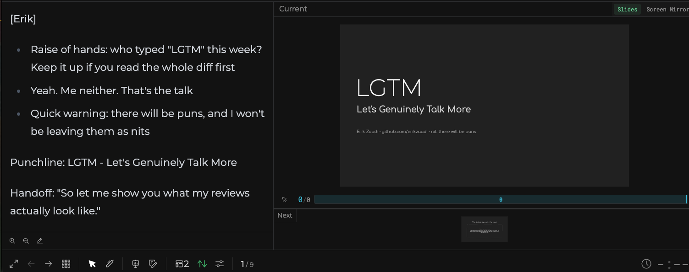

# nerdalicous-presentation-skill

```text
   .--------------------------------------------.
   |  o o o            talk.diff                |
   |--------------------------------------------|
   |  - slides that read like a document        |
   |  + a person talking to people,             |
   |  +   who happens to have slides            |
   '--------------------------------------------'
          \o/
           |      <- you, mid-pun
          / \
```

An [Agent Skill](https://agentskills.io) for building talks the way I ([Erik Zaadi](https://github.com/erikzaadi)) build them: dark slides, structural puns, a real story arc, and speaker notes that carry the talk while the slides carry the signal.

The goal is not a polished corporate deck. The goal is **a person talking to people, who happens to have slides**.

Want to see the result? My public talks, built with this skill, are at **[erikzaadi.com/slides](https://erikzaadi.com/slides/)**.

## Built on Slidev ❤️

Everything here starts in **[Slidev](https://sli.dev)**, and huge thanks to [Anthony Fu](https://github.com/antfu) and the Slidev contributors for it. Slides are a single `slides.md`, so an agent can read, reshuffle and rewrite the whole deck in one go, and you get:

- Vue components for anything Markdown can't do (diagrams, terminal windows, image, GIF and meme placeholders)
- `v-click` reveals, with `[click]` markers in the notes that light up in presenter mode
- A presenter view with editable notes that save straight back to `slides.md`
- Static builds, PDF/PNG export, and remote control for the actual talk

Google Slides (or PPTX) comes in only when it has to: co-presenters who want to edit together, or a conference that requires its own template. By then the story, the notes and the images already exist, and `references/google-slides.md` walks through the port: what stays editable, what becomes an image, and how click reveals and notes carry over.



*Presenter mode on the cover of "LGTM: Let's Genuinely Talk More". The notes on the left follow the skill's format: presenter tag, beats, punchline, handoff.*

## Install

It's a plain Agent Skill (`SKILL.md` plus `references/`, `scripts/` and `templates/`), so it works in any agent that loads skills. Clone it once, then link it into each agent's skills folder:

```sh
git clone https://github.com/erikzaadi/nerdalicous-presentation-skill.git ~/Code/nerdalicous-presentation-skill
```

| Agent | Link it into |
|---|---|
| [Claude Code](https://claude.com/claude-code) | `~/.claude/skills/` |
| [Cursor](https://cursor.com) | `~/.cursor/skills/` |
| [Codex](https://developers.openai.com/codex) | `~/.codex/skills/` |
| Others | `~/.agents/skills/`, or wherever your agent's docs say |

```sh
ln -s ~/Code/nerdalicous-presentation-skill ~/.claude/skills/nerdalicous-presentation-skill
```

Skill folders are a moving target, so check your agent's docs if it doesn't pick the skill up. Most agents also read a project-level folder (`.claude/skills/`, `.cursor/skills/`...) when you'd rather keep the skill next to one deck.

The agent picks it up whenever you work on a talk, deck or slides. You can also ask for it by name.

This is a personal style, so it's opinionated about *my* voice, palette and closing GIF. To make it yours, fork it and rewrite the "Voice & Tone", "Visual Design Language" and "The GIF Language" sections of `SKILL.md`. The workflow, the kit and the scripts are generic.

## What's inside

| Path | What it is |
|---|---|
| `SKILL.md` | The entry point: voice, story arc, visual language, and pointers to the references below. |
| `new-deck.sh` | Creates a new deck from the templates, scripts and kit. |
| `PRO-TIPS.md` | Presenting from a static build, editing notes live, and how to rehearse (including what to do when you blank). |
| `references/speaker-notes.md` | The speaker-notes format (beats, `[click]`, punchline, handoff), the notes PDF, rehearsal audio, and the rehearsal video. |
| `references/image-placeholders.md` | `<ImageTBD>` placeholders while drafting (generated image, GIF or meme), generating images, picking GIFs, making memes, and full-bleed photo slides. |
| `references/diagram-components.md` | Diagrams: Mermaid first, then native SVG/Vue components with progressive reveals. |
| `references/slidev-gotchas.md` | Things Slidev taught me the hard way: clicks, components, images, hosting, install errors. |
| `references/google-slides.md` | Porting a finished deck to Google Slides or PPTX, and checking the result. |
| `references/past-talks.md` | Frameworks from earlier talks, for when a new talk builds on them. |
| `references/kit/` | Vue components, styles and utils to copy into a deck (`TerminalWindow`, `ImageTBD`, `FieldNote`, the `Fx*` diagram primitives). Diagrams, field notes and photo slides read the palette's CSS variables, so a fork that changes the palette restyles them too. The terminal keeps its GitHub-dark colours, and the diagrams' blue, orange and purple are kit-only tokens. |
| `scripts/` | Speaker-notes PDF, rehearsal audio and video, slide-image generation, GIF search and download, and memes. They read the deck with Slidev's own parser, so slide numbers, notes and `src:` imports match what Slidev shows. |
| `templates/` | A starter `slides.md` and `style.css`, plus `package.json`, `.nvmrc`, `.gitignore` and `.env.example` for a new deck. |

## The stages of a talk

A talk is not written, it's iterated. The skill is built around stages, and it deliberately keeps the expensive parts (images, native diagrams, audio) out of the way until the story holds.

### 1. Ideation

What's the one thing the audience should walk out with? Who's in the room? What's the punny title? This stage is a conversation, not a deck. Dump notes, an old blog post, a README, a rant. Ask the agent to poke holes in it.

### 2. Story flow: do we have a story to tell?

The first draft is cheap on purpose:

- Every missing visual is an `<ImageTBD>` box, not a sentence: a GIF or meme when a famous moment is the joke, an image prompt otherwise.
- Every diagram is a plain Mermaid block.
- Every slide already has speaker notes, ending in a `Handoff:` line into the next slide.

Now read the handoffs slide after slide. If they chain into a story with a hook, tension in the middle and an earned payoff, you have a talk. If they don't, you have a list of topics, and no amount of polish fixes that. Reshuffle, merge and cut here, while slides cost nothing.

### 3. Iterate, iterate, iterate

Once the flow is agreed, two loops run side by side, many times over:

**Graphics.** Turn image prompts into generated images, pick the GIFs, make the memes, and turn them all into full-bleed photo slides. Turn the most important Mermaid diagram into a polished native component, then derive the rest from the same primitives. Render every click state and check for overflow, misaligned wires and orphaned words.

**Words.** Tighten the slide copy until nothing on screen repeats what you say aloud. Rewrite notes into beats in your own voice. Rehearse in presenter mode (`npm run dev`, then `/presenter`), fix the notes there, and play the rehearsal audio in the background (traffic, dishes, walks) until the story sticks. Every rehearsal surfaces a slide that drags or a handoff that doesn't land. [`PRO-TIPS.md`](PRO-TIPS.md) has how I rehearse, including a reset ceremony for when you blank on stage.

### 4. Ship

Build or export the deck, print the notes PDF, download every GIF and image locally (venue Wi-Fi is never your friend), and port to Google Slides only if you need to.

## Starting a new deck

Ask your agent to start a deck, or run the script yourself. You need Node 24 or newer (`nvm use` picks it up from the deck's `.nvmrc`).

```sh
~/Code/nerdalicous-presentation-skill/new-deck.sh my-talk   # wherever you cloned it
cd my-talk && npm run dev
```

`new-deck.sh` creates the folder, copies in the scripts, the kit and the templates, downloads the closing GIF, and runs `npm install`. It also installs Chromium for the notes PDF, since newer npm versions skip `playwright-chromium`'s own download. Pass `--no-install` to only copy. It refuses to touch a folder that isn't empty.

Each deck gets its own dev port (picked at random from the free ones in 3100–3999), so several decks can run at once. Slidev 53's dev server also serves an MCP server at `http://localhost:<port>/__mcp`, which lets the agent list, edit, insert, move and remove slides, and jump the open browser to the slide it just changed. `new-deck.sh` wires it up as `slidev` for each agent:

| Agent | Config it reads |
|---|---|
| Claude Code | `.mcp.json` (approve it on first use) |
| Cursor | `.cursor/mcp.json` |
| Codex | `.codex/config.toml` (trusted projects only) |

Agents connect at startup, so run `npm run dev` before starting the agent in the deck folder. If you forgot, use `/mcp` → Reconnect in Claude Code, or restart the agent elsewhere. For other agents, point their config at the same URL, or use `npx slidev mcp slides.md`, a stdio server that needs no dev server but can't move the browser.

The starter `slides.md` is five slides that follow the arc (hook, problem, honest diff, honest gaps, closing question) with notes in the expected format. It's scaffolding for the story pass, not a talk.

| Command | What it does |
|---|---|
| `npm run dev` | Slidev dev server; presenter mode at `/presenter`. |
| `npm run build` / `npm run export` | Static build / PDF export. |
| `npm run notes:pdf` | One printable card per slide: number, title, presenter, notes. |
| `npm run notes:audio` | Rehearsal MP3 of the speaker notes, one voice per presenter. |
| `npm run notes:verify` | Transcribes the rehearsal audio back and flags clips that skipped speech. |
| `npm run notes:video` | The deck as an MP4 narrated by the rehearsal audio, clicks and GIFs included (needs `ffmpeg`). |
| `npm run images` | Turns every `<ImageTBD>` prompt without an image yet into a slide image. `images:list` and `images:dry-run` cost nothing. |
| `npm run gifs:search` | Giphy candidates for every `kind="gif"` placeholder, as a contact sheet to pick from (needs `GIPHY_API_KEY`). `gifs:list` shows the placeholders and giphy.com links. |
| `npm run gifs` | Downloads each picked GIF into `public/images/` (no key). |
| `npm run memes` | Makes every `kind="meme"` placeholder into an image with memegen.link (no key). `memes:list` previews the URLs. |

## Using OpenAI for images and audio, and Giphy for GIFs

Two scripts call the OpenAI API, and GIF search calls the Giphy API (see [GIFs and memes](#gifs-and-memes) for its key). The OpenAI scripts are both opt-in, and both load `OPENAI_API_KEY` from a gitignored `.env` next to `slides.md` (an exported variable works too, and the free `--list`, `--print` and `--dry-run` modes need no key at all):

```sh
cp .env.example .env   # then paste your key
```

`.env.example` also lists every optional override, commented out with its default: the image and audio models, a deck-wide image style, a voice per presenter (`OPENAI_TTS_VOICES=erik=cedar,dana=marin`), and the kind of talk the rehearsal voice should sound like (`OPENAI_TTS_TALK=keynote`).

### Slide images

`<ImageTBD prompt="robots on a picket line" name="robot-strike" />` placeholders become full-bleed 16:9 images in `public/images/`. The whole deck goes along as context (like uploading `slides.md` to ChatGPT), so each image knows the talk's story, tone and recurring characters.

```sh
npm run images:list                     # number the placeholders, mark the ones that exist
npm run images:dry-run                  # see the requests and briefs, spend nothing
npm run images                          # generate every missing image (existing ones are skipped)
npm run images -- --only 2,5            # just these; add --force to regenerate
npm run images -- --style-ref public/images/robot-strike.png   # match an earlier image's style
```

Look at every image before using it: generators still garble on-image text. Then hand them to your agent; the script prints this prompt with the slide numbers filled in:

> I generated the images for slides 2, 5. Swap their ImageTBD placeholders for full-bleed photo slides.

The agent replaces each placeholder with a `layout: image` photo slide and moves the on-screen title into the notes as the spoken opener.

### GIFs and memes

Not every visual should be generated. When a famous film or TV moment *is* the joke, the placeholder is a GIF; when a familiar meme template with your own caption is the joke, it's a meme. The skill offers these while drafting:

```md
<ImageTBD kind="gif" prompt="we need to go deeper" source="Inception" name="go-deeper" />
<ImageTBD kind="meme" template="yodawg" top="Yo dawg, I heard you like managers" bottom="so we put a manager in your manager" />
```

**Memes** need nothing: [memegen.link](https://memegen.link) is free, with no account or key.

```sh
npm run memes -- --templates brain   # find template ids (Galaxy Brain is "gb", with lines="a|b|c|d")
npm run memes:list                   # each meme's URL, to preview in a browser
npm run memes                        # download the missing ones into public/images/
```

**GIFs** are semi-automatic, because picking the right GIF takes taste and the top search hit is often a near miss. The script searches and downloads; you pick.

```sh
npm run gifs:list     # placeholders, their picks, and giphy.com search links (no key)
npm run gifs:search   # writes gif-picks.html: candidates per slide, click one each
npm run gifs          # downloads every pick="..." into public/images/ (no key)
```

The contact sheet turns your clicks into a prompt for your agent, which adds `pick="<id>"` to each placeholder, runs `npm run gifs`, and swaps the placeholders for GIF slides. You can also skip the sheet: browse giphy.com and paste a GIF's page URL into `pick="..."` yourself.

#### Getting a Giphy API key

Only `gifs:search` needs one, and it's free:

1. Sign in (or sign up) at the [Giphy developer dashboard](https://developers.giphy.com/dashboard/).
2. Click **Create an App**, choose **API** (not SDK), and give it a name and a one-line description, like "Slide GIF picker".
3. Copy the key into the deck's `.env`, next to `slides.md`:

   ```sh
   GIPHY_API_KEY=your-key-here
   ```

New keys are rate-limited, which is plenty for a deck. `gifs:search` stops before doing anything when the key is missing, and says so when Giphy rejects it or the rate limit runs out. `GIPHY_RATING` in `.env` sets the content rating (default `pg-13`). Giphy's API terms ask for attribution, so the contact sheet carries a "Powered by GIPHY" line.

### Rehearsal audio

Your speaker notes, read aloud, one voice per presenter, so you can rehearse away from the screen.

```sh
npm run notes:audio -- --print       # the exact text each voice will say
npm run notes:audio -- --dry-run     # requests and voices, no cost
npm run notes:audio                  # writes speaker-notes.mp3
npm run notes:audio -- --voice-dana marin --lang he   # one-off voice; Hebrew notes
npm run notes:verify                 # transcribe it back, flag skipped speech
npm run notes:video                  # writes speaker-notes.mp4: the slides, narrated
```

Clips are cached by content, so editing one slide regenerates only that slide's clips. Long requests make the voice silently skip passages, which is why the script keeps them short and why `notes:verify` exists. Its word-overlap check is a heuristic, so still listen to the slides it flags.

The default model names were current in October 2026. OpenAI retires models regularly, so check their [deprecations page](https://platform.openai.com/docs/deprecations) before a new deck and point `OPENAI_IMAGE_MODEL`, `OPENAI_IMAGE_CONTEXT_MODEL`, `OPENAI_TTS_MODEL` and `OPENAI_TRANSCRIBE_MODEL` in `.env` at the replacements. `OPENAI_TTS_MODEL` covers the Chat Completions audio models and the classic speech endpoint; a Realtime-only model would need script changes (details in `references/speaker-notes.md`). The audio file is AI-generated: it's for your own rehearsal, not for publishing as your voice.

## A real session

**[LGTM: Let's Genuinely Talk More](https://slides.erikzaadi.com/testing-out-presentation-skill/)** went from an empty folder to the deck below in three prompts, about six minutes of agent time.


1. **`/nerdalicous-presentation-skill`**. The skill asked what the talk was about, who presents, the notes language and the kind of talk, in one round ("testing the skill", just me, English, internal). It ran `new-deck.sh`, picked a topic, and wrote a nine-slide story-first draft: an `ImageTBD` prompt for the cowboy, plain Mermaid for the diagram, and notes on every slide with `[Erik]`, `Punchline:` and a `Handoff:` into the next slide. Then it exported every slide and fixed the titles that ended on a single dangling word.
2. **`npm run images`**, then **"I've generated the tbd images, can you add them?"** The placeholder became a full-bleed photo slide, and its title moved into the notes.
3. **"please do"**, to its offer of a styled diagram. The Mermaid became `GreenCheckGap.vue`, built from the kit: the PR pipeline first, then on click the conversation that never makes it into the diff.

The run also showed what the skill was missing (card styles, a working diagram example, its stance on made-up numbers), and those fixes are in it now.

## Prompt examples

Starting out:

- "I'm giving a 30 minute talk on platform engineering at a DevOps meetup. Help me find the story before we touch any slides."
- "Here's my blog post. Turn it into a Slidev deck, story first, image prompts instead of images."
- "Two presenters, Dana and me, notes in English. Draft the flow for our talk on incident reviews."

Checking the story:

- "Read only the handoffs, slide after slide. Where does the story break?"
- "Which slide could someone leave after and feel done? Fix the hook."
- "Where's the honest-gaps slide?"

Iterating on graphics:

- "List the image placeholders and generate 3 and 7."
- "Which slides would land better with a GIF or a meme? Swap their image prompts."
- "Search GIFs for the GIF placeholders." Then, after clicking through `gif-picks.html`: paste the prompt it builds.
- "Make the memes and swap them in."
- "I generated the images for slides 2, 5. Swap their ImageTBD placeholders for full-bleed photo slides."
- "Turn the Mermaid pipeline on slide 6 into a native diagram with three click states, then render every state and check it."
- "Slide 12 has an orphaned word in the title. Fix the copy, not the font size."

Iterating on words:

- "Rewrite the notes for slides 4 to 9 as beats in my voice, with `[click]` markers matching the reveals."
- "Make the opening punnier. I want a groan."
- "Generate the rehearsal audio and verify nothing got skipped."

Shipping:

- "Make the build work on static hosting and download all the GIFs locally."
- "The conference requires their Google Slides template. Port the deck, keep the notes."

## Fin

I'd tell you a joke about Slidev, but the punchline is behind a `[click]`.


